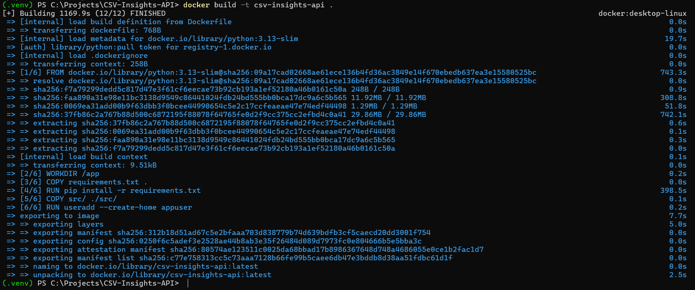
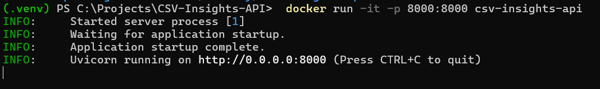
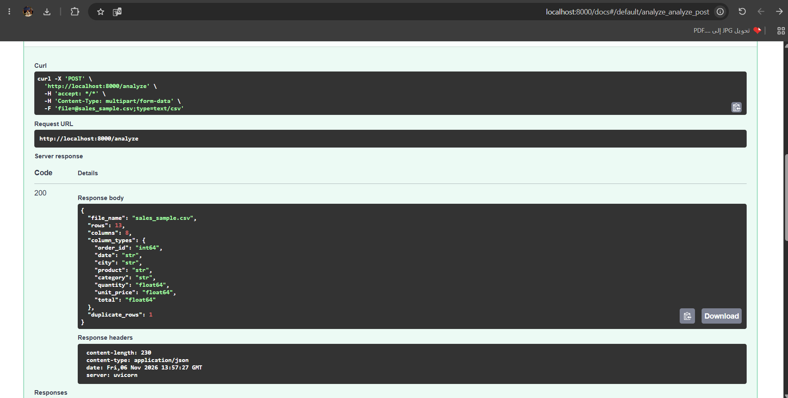
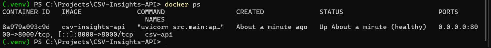
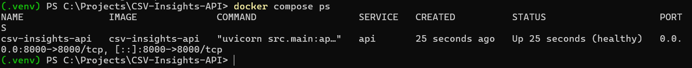
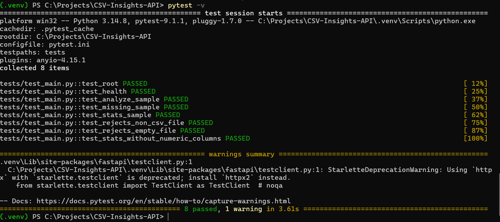
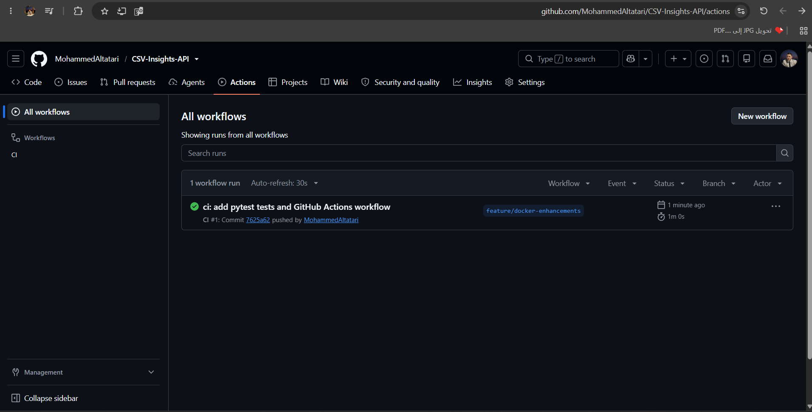
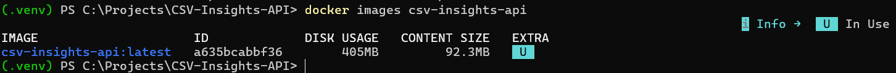
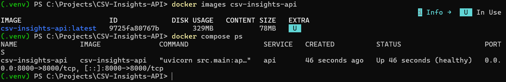

# CSV Insights API

[](https://github.com/MohammedAltatari/CSV-Insights-API/actions/workflows/ci.yml)

A lightweight REST API that profiles CSV datasets instantly. Upload a CSV file and get its structure, a missing-value report, and descriptive statistics - the first checks every data analyst runs before cleaning or modeling data.

The service runs inside a Docker container, so it behaves the same on any machine that has Docker installed.

---

## Features

| Endpoint | Method | Description |
|----------|--------|-------------|
| `/` | GET | Service info and useful links |
| `/health` | GET | Health check - returns `{"status": "ok"}` |
| `/analyze` | POST | Rows, columns, data type of each column, and duplicate rows |
| `/missing` | POST | Missing-value count and percentage for each column |
| `/stats` | POST | Count, mean, median, standard deviation, min and max for numeric columns |
| `/docs` | GET | Interactive API documentation (Swagger UI) |

Uploads are validated: only `.csv` files are accepted, empty files are rejected, and the maximum file size is 5 MB.

---

## Tech Stack

| Layer | Technology |
|-------|------------|
| Language | Python 3.13 |
| Web framework | FastAPI 0.162 |
| ASGI server | Uvicorn 0.54 |
| Data processing | pandas 3.1 |
| Containerization | Docker (multi-stage build on `python:3.13-slim`), Docker Compose |
| Testing and CI | pytest, GitHub Actions |
| Version control | Git + GitHub |

---

## Project Structure

```text
CSV-Insights-API/
├── src/
│   ├── __init__.py
│   └── main.py              # FastAPI application
├── sample_data/
│   └── sales_sample.csv     # Sample dataset for testing
├── tests/
│   └── test_main.py         # pytest tests (8 tests)
├── .github/
│   └── workflows/
│       └── ci.yml           # GitHub Actions: tests + Docker build and run
├── docs/
│   ├── screenshots/         # Build, run and test screenshots
│   └── notes.md             # Technical notes
├── Dockerfile               # Multi-stage build with healthcheck
├── docker-compose.yml
├── .dockerignore
├── .gitignore
├── .gitattributes
├── requirements.txt         # Runtime dependencies (pinned)
├── requirements-dev.txt     # Development and test dependencies
├── pytest.ini
└── README.md
```

---

## Run with Docker

### Prerequisites

- [Docker Desktop](https://www.docker.com/products/docker-desktop/) installed and running (wait until it shows **Engine running**)
- Git

### 1. Clone the repository

```bash
git clone https://github.com/MohammedAltatari/CSV-Insights-API.git
cd CSV-Insights-API
```

### 2. Build the image

```bash
docker build -t csv-insights-api .
```

The first build downloads the base image and installs the dependencies, so it can take a few minutes. Later builds reuse the cached layers and finish in seconds.

### 3. Run the container

```bash
docker run -it -p 8000:8000 csv-insights-api
```

The API is ready when the terminal shows:

```text
INFO:     Uvicorn running on http://0.0.0.0:8000 (Press CTRL+C to quit)
```

### 4. Open the API

Go to **http://localhost:8000/docs** in your browser.

### Alternative: run with Docker Compose

Build and start the service with one command (in the background):

```bash
docker compose up -d --build
```

Check that it is running and healthy:

```bash
docker compose ps
```

Stop and remove it:

```bash
docker compose down
```

---

## Stop and Clean Up

Stop the running container by pressing `Ctrl + C` in its terminal.

Optional cleanup:

```bash
# list all containers, including stopped ones
docker ps -a

# remove a stopped container (use the CONTAINER ID from the list)
docker rm <container-id>

# remove the image
docker rmi csv-insights-api
```

---

## Configuration

| Setting | Value | Notes |
|---------|-------|-------|
| Container port | `8000` | Uvicorn listens on `0.0.0.0:8000` inside the container |
| Host port | `8000` | Set by `-p 8000:8000`; to use another port, change the left number, e.g. `-p 9000:8000` then open `http://localhost:9000/docs` |
| Max upload size | 5 MB | Defined by `MAX_FILE_SIZE` in `src/main.py` |
| Environment variables | None required | The service runs with no extra configuration |
| Container user | `appuser` | The application runs as a non-root user |
| Healthcheck | every 30s | Calls `/health`; `docker ps` shows `(healthy)` when the API responds |

---

## How to Test

### Option 1 - Swagger UI (browser)

1. Open **http://localhost:8000/docs**
2. Click **POST /analyze**, then **Try it out**
3. Choose `sample_data/sales_sample.csv` and click **Execute**
4. You should get status `200` with `"rows": 13`, `"columns": 8` and `"duplicate_rows": 1`

Repeat the same steps with **/missing** and **/stats**.

### Option 2 - Command line (curl)

```bash
# health check
curl http://localhost:8000/health

# profile the sample dataset
curl -X POST http://localhost:8000/analyze -F "file=@sample_data/sales_sample.csv"
curl -X POST http://localhost:8000/missing -F "file=@sample_data/sales_sample.csv"
curl -X POST http://localhost:8000/stats   -F "file=@sample_data/sales_sample.csv"
```

> On Windows PowerShell, type `curl.exe` instead of `curl`.

### Expected results for the sample dataset

| Endpoint | Key result |
|----------|------------|
| `/analyze` | 13 rows, 8 columns, 1 duplicate row |
| `/missing` | `total`: 2 missing (15.38%); `city`, `quantity`, `unit_price`: 1 missing each (7.69%) |
| `/stats` | 4 numeric columns; e.g. `total` has mean `22.77` and median `20.0` |

### Error handling

| Situation | Status code |
|-----------|-------------|
| File is not `.csv` | `400` |
| File is empty or cannot be parsed | `400` |
| File is larger than 5 MB | `413` |
| `/stats` on a file with no numeric columns | `422` |

---

### Automated tests (pytest)

```bash
pip install -r requirements-dev.txt
pytest -v
```

All 8 tests cover every endpoint with the sample dataset and the error cases above. The same tests run automatically on GitHub Actions.

---

## Docker and CI Enhancements

| Enhancement | What it does | Where |
|-------------|--------------|-------|
| Docker Compose | Builds and runs the API with `docker compose up -d --build` | `docker-compose.yml` |
| Healthcheck | Docker calls `/health` every 30 seconds and marks the container `healthy` or `unhealthy` | `Dockerfile` |
| Multi-stage build | A `builder` stage installs the dependencies and removes the test suites bundled inside packages; the final stage copies only the installed packages and the source code | `Dockerfile` |
| GitHub Actions CI | On every push and pull request: runs pytest, then builds the image, starts the container, waits until it is healthy and calls the API | `.github/workflows/ci.yml` |

### Image size: single-stage vs multi-stage

| Build | Disk usage | Content size |
|-------|-----------|--------------|
| Single-stage | 405 MB | 92.3 MB |
| Multi-stage | 329 MB | 78 MB |
| **Saved** | **76 MB (~19%)** | **14.3 MB (~15%)** |

---

## Run Locally without Docker (optional)

```bash
python -m venv .venv
# Windows: .\.venv\Scripts\Activate.ps1   |   Linux/macOS: source .venv/bin/activate
pip install -r requirements-dev.txt
uvicorn src.main:app --reload
```

Then open **http://127.0.0.1:8000/docs**.

---

## Screenshots

| Step | Screenshot |
|------|------------|
| Docker build success |  |
| Container running |  |
| API working in the browser |  |
| Container healthy (healthcheck) |  |
| Running with Docker Compose |  |
| All tests passing |  |
| GitHub Actions passing |  |
| Image size before multi-stage |  |
| Image size after multi-stage |  |

---

## Sample Data

`sample_data/sales_sample.csv` is a small synthetic sales dataset created for testing. It intentionally contains missing values and one duplicate row so every endpoint returns meaningful results.

---

## Author

**Mohammed Altatari** - [GitHub](https://github.com/MohammedAltatari)

This project was built from scratch; it is not based on an existing open-source project.
