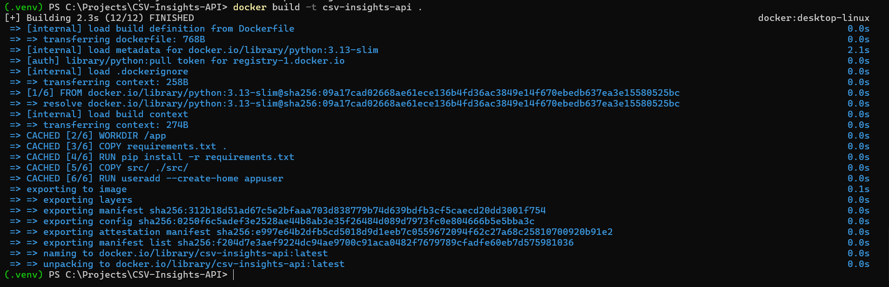

# Technical Notes

## Biggest Docker Problem and How I Solved It

**Problem:** The first `docker build` took about **20 minutes** (`Building 1169.9s`). Pulling the `python:3.13-slim` base image took ~743s and `pip install -r requirements.txt` took ~398s on a slow network connection. Rebuilding like this after every code change would make development very slow.

**Cause:** Docker builds an image as a stack of layers, one per instruction in the `Dockerfile`. When an instruction or the files it copies change, that layer **and every layer after it** must be rebuilt. If the source code were copied before installing the dependencies, any change in `src/main.py` would force `pip install` to run again.

**Solution:** I ordered the `Dockerfile` so the slow, rarely-changing steps come first:

```dockerfile
COPY requirements.txt .
RUN pip install -r requirements.txt   # cached unless requirements.txt changes
COPY src/ ./src/                      # only this layer is rebuilt after code edits
```

I also added a `.dockerignore` so `.venv/`, `.git/`, caches and docs are not sent to Docker (the build context was only **9.51 kB**).

**Result:** Running the same `docker build` again finished in **2.3 seconds** instead of 1169.9 seconds - every step from `[2/6]` to `[6/6]` was marked `CACHED`.

| Build                        | Time     |
| ---------------------------- | -------- |
| First build (no cache)       | 1169.9 s |
| Second build (cached layers) | 2.3 s    |



## Most Important Git/GitHub Lesson

**Problem:** On `git add .`, Git printed `warning: ... LF will be replaced by CRLF` for every file.

**What I learned:** Windows ends each line with two characters (`CRLF`) while Linux uses one (`LF`). Git on Windows was converting the files. Python itself does not mind, but files that run inside a Linux container (shell scripts, a `Makefile`, `Dockerfile` instructions) can break with Windows line endings.

**Solution:** I added a `.gitattributes` file with `* text=auto eol=lf`, so every text file is stored with Linux line endings in the repository and inside the Docker image. The warnings disappeared and the project behaves the same on Windows, Linux and in the container. The lesson: **a repository should define its own rules** (`.gitignore`, `.gitattributes`) instead of depending on each developer's machine settings.

---

## Development Log (problems met during setup)

| #   | Problem                                                        | Cause                                                                              | Fix                                                                                                                                                               |
| --- | -------------------------------------------------------------- | ---------------------------------------------------------------------------------- | ----------------------------------------------------------------------------------------------------------------------------------------------------------------- |
| 1   | Column `quantity` was detected as `float64` instead of `int64` | pandas stores missing values as `NaN` (a float), so the whole column becomes float | Expected behaviour - documented so the API output is not misread                                                                                                  |
| 2   | First `docker build` took ~20 minutes                          | Slow network: pulling `python:3.13-slim` (~743s) and `pip install` (~398s)         | Expected for the first build only - `requirements.txt` is copied and installed before the source code, so the second build reused the cached layers and took 2.3s |
